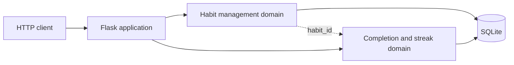
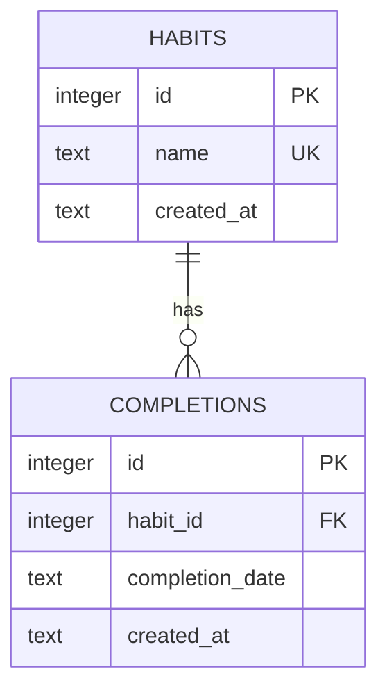

# Habit Tracker

A small Flask and SQLite habit tracker for Assignment 1. It supports two backend domains:

- **Habit management:** create, list, and delete habits.
- **Completion tracking:** record daily completions, view completion history, and calculate consecutive streaks.

The application is a single-process monolith. The two domains share the SQLite database now, but the boundary between them is designed so they could be separated for Assignment 2.

## Requirements

- Python 3.12
- Flask 3.1.2
- SQLite
- Docker, if using the container setup

## Run Locally

Create and activate the Conda environment, then install the dependencies:

```bash
conda create --name habit-tracker python=3.12 pip --yes
conda activate habit-tracker
python -m pip install -r requirements.txt
```

Start the application:

```bash
DATA_DIR=./data PORT=8000 python app.py
```

The API is available at `http://localhost:8000`. The application reads these environment variables:

| Variable | Default | Purpose |
|---|---|---|
| `PORT` | `8000` | Port used by Flask. |
| `DATA_DIR` | `/data` | Directory containing the SQLite database. |

The database file is `$DATA_DIR/habits.sqlite3`. The schema is created automatically on first startup and existing data is preserved.

## API

| Method | Path | Purpose |
|---|---|---|
| `GET` | `/` | Confirm the application is running. |
| `GET` | `/habits` | List habits. |
| `POST` | `/habits` | Create a habit with `{"name": "Read"}`. |
| `DELETE` | `/habits/<id>` | Delete a habit and its completions. |
| `POST` | `/habits/<id>/completions` | Record a completion with an optional `completion_date`. |
| `GET` | `/habits/<id>/completions` | List completion history. |
| `GET` | `/habits/<id>/streak` | Return the current consecutive-day streak. |

Completion dates use `YYYY-MM-DD`. Future dates are rejected, and submitting the same completion twice does not create a duplicate row.

## Architecture



`app.py` contains the HTTP layer, database setup, and both domain responsibilities. Habit management owns habit lifecycle data. Completion tracking owns completion dates and streak calculations and references a habit through `habit_id`.

## Database Schema



`completions` has a unique constraint on `(habit_id, completion_date)`. Foreign keys use cascade deletion so deleting a habit also removes its completion records.

## Tests

Run the automated tests and coverage report with:

```bash
PYTHONPATH=. conda run --name habit-tracker pytest -q --cov=app --cov-report=term-missing tests
```

The current result is **8 tests passed with 98% coverage**. Tests use temporary SQLite directories and cover both domain areas, validation, persistence, duplicate completions, streak gaps, and cascade deletion.

## Docker

Build and run the application with the provided root Dockerfile:

```bash
docker build -t habit-tracker .
docker run --rm -p 8000:8000 -v habit-tracker-data:/data habit-tracker
```

Then open `http://localhost:8000/`. The container runs `python app.py`, binds to `0.0.0.0`, and stores the database under `/data`.

Run the provided contract checker before submission:

```bash
./container/run.sh .
```

The checker uses a portable temporary-file template so it works on this Linux environment. The successful output is:

```text
=== SDD Assignment 1 contract check ===
Repository: /home/flipman/Documents/Class_Projects/Devops/sdd-assignment-1

==> Repository shape
    PASS  one Dockerfile, one manifest (requirements.txt)

==> Build from a clean context, no build args
    PASS  image built
    PASS  image size 52 MB

==> Start on PORT=8000 and reach it from the host
    PASS  HTTP 200 from http://localhost:8000/

==> SQLite file under DATA_DIR
    PASS  found in /data: habits.sqlite3

==> Data persists, and a second boot does not re-seed
    PASS  volume at /data persists
    PASS  row counts unchanged across restart: completions=0 habits=0

==> PORT override is honoured (not hardcoded)
    PASS  HTTP 200 from http://localhost:9123/

=== ALL CHECKS PASSED ===
```

## SDLC and SMART Goals

This project uses an iterative SDLC approach. I built the application in small slices: choose the stack, define the two domains, implement SQLite persistence, add tests, and then verify the container contract. Each slice was tested before moving to the next one.

The SMART goals were to complete the two SQLite-backed domains by the deadline, reach at least 70% automated coverage of core logic, make the application start with one Docker command, and document the decisions and testing evidence in the repository.

## AI Disclosure

I acknowledge the use of GitHub Copilot to plan the application, create an initial implementation, write tests, and review documentation. The prompts used include requests to plan a Flask and SQLite habit tracker, create `app.py`, write tests, and document architectural decisions. The output was reviewed, modified where needed, tested locally, and recorded in `AI_USAGE.md`.
